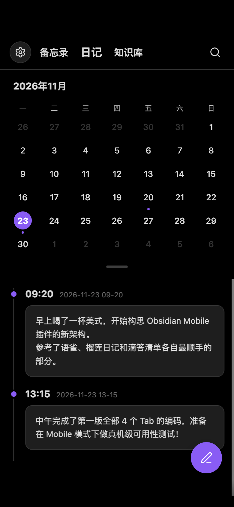

# Obsidian Mobile Hub

一款专为 **Obsidian 移动端（手机）** 打造的界面重塑插件。参考语雀与榴莲日记的移动端交互体验，用 **备忘录 / 日记 / 知识库** 三大高频视图替代原生复杂抽屉，同时 **100% 复用 Obsidian 原生 Markdown 编辑器与主题 CSS 变量**，仅在手机端自动激活、桌面端完全静默零干扰。

---

## 效果预览

<table>
  <tr>
    <td align="center"><b>备忘录（小记卡片流）</b></td>
    <td align="center"><b>日记（日历 + 一天多篇时间轴）</b></td>
    <td align="center"><b>知识库（整块分组列表）</b></td>
    <td align="center"><b>知识库（树形目录 + 拖拽）</b></td>
  </tr>
  <tr>
    <td></td>
    <td></td>
    <td></td>
    <td></td>
  </tr>
</table>

---

## 核心特性

- **仅手机端生效**：自动检测设备（`Platform.isPhone`），桌面端 / 大屏平板完全静默，可放心跨端同步仓库。
- **100% 原生主题融合**：全部颜色、字体、圆角复用 Obsidian CSS 变量，自动适配深色 / 浅色模式及任意第三方主题。
- **原生级 ViewPager 跟手滑动**：内容区手指左右滑实时跟手切换 `备忘录 ↔ 日记 ↔ 知识库`，同时屏蔽原生左右抽屉误触。
- **沉浸式编辑体验**：
  - 全量复用 Obsidian 原生 Markdown 编辑器（保留双链、插件、实时预览）；
  - 编辑页隐藏冗余顶栏/底栏，顶部仅留极简 `<` 返回键，返回时完整保留各 Tab 日期、折叠态与滚动位置；
  - 新建备忘录/日记未写内容直接返回时，自动静默清理空草稿。
- **备忘录 Tab**：卡片流预览 + 底部渐隐遮罩 + 触底分页懒加载（适配 4000+ 文件大库），点 `...` 弹出三层式底部抽屉。
- **日记 Tab**：
  - 上半部分日历支持左右滑切月、拖拽中间 `handler` 在月视图/周视图间切换、点击年月弹出居中年月选择器；
  - 下半部分支持**一天多篇**贯穿式时间轴（按 Frontmatter `date` → 文件名 → `ctime` 三层解析）、图片 3 列缩略图与全屏 Lightbox 预览、长按弹底部抽屉。
- **知识库 Tab**：
  - 自动聚合根目录其余文件夹（默认排除 `备忘录`、`日记`、`assets`，可在设置中自定义）；
  - 进入文件夹后隐藏主 Tab 栏，顶部显示 `左 < | 中 居中标题 | 右 ...`；
  - 支持多级目录折叠、长按拖拽排序（自定义顺序存于 `data.json`，不修改文件名）与跨文件夹移动。

---

## 安装方式

### 方式一：手动安装（推荐）

1. 下载本仓库根目录或 Release 中的 3 个文件：
   - `manifest.json`
   - `main.js`
   - `styles.css`
2. 放入你的 Obsidian 仓库插件目录：
   ```text
   <你的仓库>/.obsidian/plugins/obsidian-mobile-hub/
   ```
3. 在手机端 Obsidian 打开 **设置 → 第三方插件**，刷新后开启 **Mobile Hub**。

### 方式二：从源码构建

```bash
npm install
npm run build
```

构建产物会生成在仓库根目录的 `main.js` 和 `styles.css`。

---

## 目录与数据约定

可在 **设置 → Mobile Hub** 中自定义文件夹名称与排除项：

| Tab | 默认目录 | 说明 |
| :--- | :--- | :--- |
| **备忘录** | `备忘录/` | 按修改时间倒序展示卡片流，新建命名 `YYYY-MM-DD HH-mm.md` |
| **日记** | `日记/` | 1 篇 = 1 `.md`，优先读 Frontmatter `date: YYYY-MM-DD HH:mm`，兜底解析文件名与创建时间 |
| **知识库** | 其余根目录文件夹 | 默认排除 `备忘录`、`日记`、`assets`（可自定义） |

---

## License

[MIT](./LICENSE)
